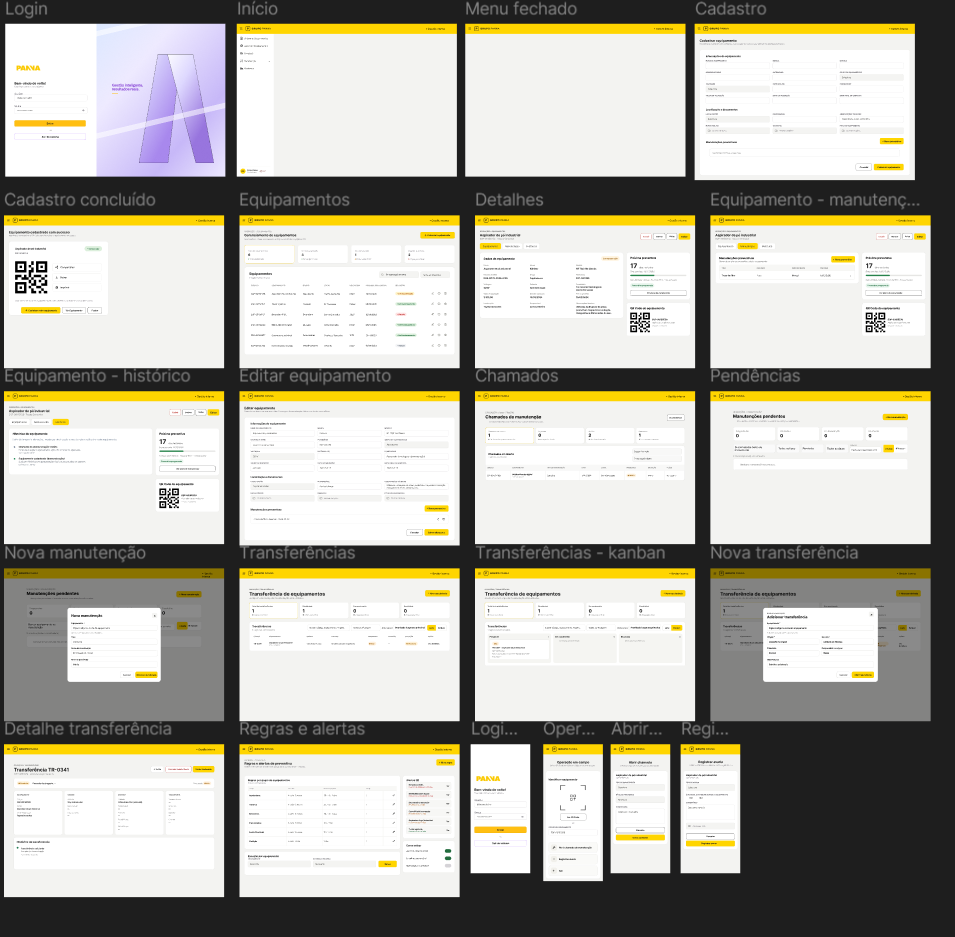

# Panna Assets

**Sistema de Gestão de Equipamentos, Manutenções e Transferências**

Projeto acadêmico desenvolvido na **Fatec Votorantim**, em parceria com o **Grupo Panna**.

## Sobre o projeto

O Panna Assets é um projeto acadêmico desenvolvido por estudantes da Fatec Votorantim em parceria com o Grupo Panna. A iniciativa aproxima o conhecimento adquirido em sala de aula das necessidades do ambiente empresarial, propondo uma solução tecnológica para a gestão dos equipamentos utilizados pela empresa.

A proposta consiste em desenvolver um sistema web que centralize informações sobre equipamentos, organize manutenções preventivas e corretivas e permita acompanhar transferências entre unidades, contribuindo para a organização, a rastreabilidade e a eficiência operacional.

## Equipe de desenvolvimento

O projeto é desenvolvido por uma equipe de estudantes da Fatec Votorantim, reunindo conhecimentos de levantamento de requisitos, prototipagem, design de interfaces e desenvolvimento web.

| Integrante | GitHub |
| --- | --- |
| Alanis Aparecida Laureano Domingues | --- |
| Fernando Terumasa Ikeda Son| https://github.com/FernandoTISon |
| Jessica Latance | https://github.com/JessicaLatance |
| Talita Ramos Lauriano Akyama | --- |
| Sara Gongora | https://github.com/saragongora |

**Instituição:** Fatec Votorantim  
**Empresa parceira:** Grupo Panna  
**Curso:** Desenvolvimento de Software Multiplataforma

## Contexto e problemática

A gestão de equipamentos distribuídos entre diferentes locais envolve o acompanhamento de informações patrimoniais, condições operacionais, manutenções e movimentações. O projeto busca atender a três necessidades centrais:

| Necessidade | Desafio |
| --- | --- |
| Gestão de equipamentos | Centralizar dados técnicos, localização, responsáveis e situação operacional. |
| Gestão de manutenções | Organizar preventivas, acompanhar chamados corretivos, prioridades, prazos e insumos. |
| Gestão de transferências | Acompanhar a movimentação dos equipamentos entre unidades, desde a solicitação até o recebimento. |

A proposta busca reduzir a fragmentação das informações, facilitar a consulta ao histórico dos equipamentos e apoiar a tomada de decisões administrativas.

## Objetivos

### Objetivo geral

Desenvolver um sistema web integrado para apoiar a gestão do ciclo operacional dos equipamentos do Grupo Panna.

### Objetivos específicos

- Centralizar o cadastro e a consulta de equipamentos.
- Facilitar o acompanhamento da disponibilidade e da localização dos ativos.
- Organizar o planejamento e a execução de manutenções preventivas e corretivas.
- Permitir que operadores registrem chamados e avarias.
- Acompanhar transferências entre unidades e registrar suas etapas.
- Manter um histórico das ocorrências e movimentações de cada equipamento.
- Oferecer uma interface intuitiva e responsiva para administradores e operadores.

## Solução proposta

O Panna Assets reúne três módulos principais em uma única plataforma, com interfaces específicas para os perfis de administrador e operador.

### Gestão de equipamentos

Cadastro, pesquisa, edição, inativação, reativação e exclusão de equipamentos, com consulta de dados técnicos, patrimoniais, localização, situação operacional e histórico individual.

### Gestão de manutenções

Planejamento de preventivas com periodicidade e insumos, registro de avarias e chamados corretivos, análise de solicitações pelo administrador, acompanhamento por prioridade e situação, registro de execução e reagendamento de preventivas recorrentes. As manutenções podem ser visualizadas em lista ou Kanban.

### Gestão de transferências

Cadastro e acompanhamento de transferências entre unidades, com situações **Pendente**, **Em movimento** e **Recebida**, visualização em lista ou Kanban e registro progressivo de informações de transporte e recebimento. A localização do equipamento é atualizada após a confirmação do recebimento.

### Perfis de acesso

| Administrador | Operador |
| --- | --- |
| Gerenciar equipamentos | Identificar equipamentos pelo código |
| Analisar chamados de manutenção | Abrir chamados de manutenção |
| Planejar e acompanhar manutenções | Registrar avarias |
| Gerenciar transferências | Utilizar a interface de operação em campo |
| Consultar históricos | |

## Vídeo pitch

O vídeo pitch apresenta o contexto do projeto, os desafios identificados, a solução proposta e uma demonstração do sistema.

**Vídeo pitch:** [link].

## Prototipagem e design de interface

A prototipagem no Figma foi utilizada para estruturar as interfaces, organizar os fluxos de navegação e orientar o desenvolvimento do front-end. O design considera as necessidades dos dois perfis de acesso e a utilização em diferentes tamanhos de tela.

**Protótipo interativo:**

## Demonstração do sistema

O front-end está disponível online para avaliação e demonstração acadêmica.

**Acesse:** [pannaassets.vercel.app](https://pannaassets.vercel.app/)

### Credenciais de demonstração

| Perfil | Usuário | Senha |
| --- | --- | --- |
| Administrador | `adm` | `123` |
| Operador | `operador` | `123` |

O ambiente contém equipamentos e ocorrências fictícios para demonstrar as funcionalidades. As credenciais são exclusivamente demonstrativas e não representam autenticação segura de produção.

## Desenvolvimento e estágio atual

O projeto encontra-se na fase de prototipagem e desenvolvimento front-end. A versão atual permite simular os principais fluxos de gestão, utilizando armazenamento local no navegador.

| Etapa | Situação |
| --- | --- |
| Definição do problema e da proposta | Realizada |
| Prototipagem de interfaces | Realizada |
| Desenvolvimento front-end | Implementado, sujeito a melhorias |
| Fluxos de equipamentos, manutenções e transferências | Implementados no protótipo |
| Hospedagem do front-end | Realizada |
| Desenvolvimento back-end e API | Planejado |
| Banco de dados centralizado | Planejado |
| Autenticação segura e integração completa | Planejada |
| Testes integrados e validação para uso real | A realizar |

## Tecnologias utilizadas

| Tecnologia | Aplicação no projeto |
| --- | --- |
| Figma | Prototipagem e design das interfaces |
| HTML5 | Estrutura das páginas |
| CSS3 | Estilização, layout e responsividade |
| JavaScript (Vanilla JS) | Interatividade, regras de negócio e simulação dos fluxos |
| Web Storage (localStorage e sessionStorage) | Persistência local e sessão demonstrativa |
| Git e GitHub | Versionamento e organização do código |
| Vercel | Hospedagem do front-end |

## Próximas etapas

A continuidade do projeto prevê a evolução do protótipo para uma aplicação integrada, com dados compartilhados e controle de acesso adequado.

- Desenvolvimento do back-end e de uma API para integração com o front-end.
- Modelagem e implementação de um banco de dados centralizado.
- Autenticação segura e autorização por perfil no servidor.
- Integração dos módulos com a persistência centralizada.
- Geração e leitura funcional de QR Codes, com validação do fluxo de câmera.
- Armazenamento de fotos e anexos.
- Desenvolvimento de relatórios e indicadores gerenciais.
- Testes de integração, usabilidade, segurança e validação das regras de negócio.

As tecnologias específicas de back-end e banco de dados serão definidas nas próximas etapas do projeto.

## Como executar localmente

1. Baixe ou clone este repositório.
2. Abra a pasta do projeto no Visual Studio Code.
3. Utilize um servidor local, como a extensão Live Server.
4. Abra o arquivo `index.html` e utilize as credenciais de demonstração.

Não é necessário instalar dependências para executar a versão atual.

## Limitações da versão atual

O Panna Assets é um protótipo acadêmico, ainda sem back-end e banco de dados centralizado. Os dados são armazenados no navegador e não são sincronizados entre dispositivos. A limpeza do armazenamento local pode excluir registros. O login é demonstrativo e não deve ser utilizado como mecanismo de segurança em produção.

A versão atual destina-se à apresentação, avaliação e validação da proposta, não ao armazenamento de informações empresariais reais.

---

**Panna Assets — Fatec Votorantim × Grupo Panna**  
Projeto acadêmico em desenvolvimento.
